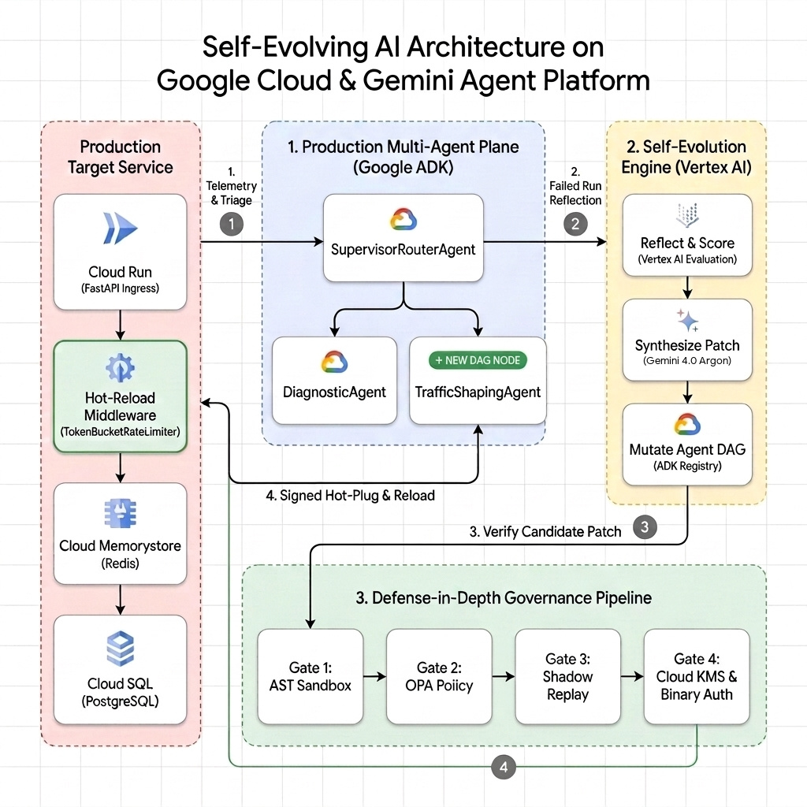

# Architecting Governed, Self-Evolving AI Agents on Gemini Enterprise Agent Platform (Project Chrysalis)

[](https://cloud.google.com/)
[](https://pypi.org/project/google-adk/)
[-34A853)](https://cloud.google.com/vertex-ai)
[](https://www.python.org/)
[](LICENSE)
[](.github/workflows/tests.yml)

> 📖 **Google Cloud Blog Post & Enterprise Agent Platform Edition:**  
> - **Blog Post:** [Architecting Governed, Self-Evolving AI Agents on Gemini Enterprise Agent Platform](https://developers.googleblog.com/architecting-governed-self-evolving-ai-agents-on-gemini-agent-platform)  
> - **Architecture Specification:** [docs/architecture_specification.md](docs/architecture_specification.md)  
> - **Google Cloud Agent Platform Edition (Recommended):** [`agent_platform_version/`](agent_platform_version/README.md) — Gemini-synthesized hotpatches behind sandbox gates, Cloud KMS code signing + Binary Authorization, Policy-as-Code controller, a Tier-2 dual-custody Human-in-the-Loop (HITL) approval modal, and BigQuery Dream-RSI counterfactual sweeps.



This repository resolves the fundamental SRE trilemma (**Exploration Risk**, **Brittle Generalization**, and **Coarse Credit Assignment**) by unifying three recursive self-improvement paradigms into an extensible multi-agent framework built with **Google Agent Development Kit (ADK) 2.0** (`google-adk`) and powered by **Gemini 4.0 Argon on Vertex AI**.

Every LLM decision point in the system—from root triage routing to principle distillation and curiosity chaos probing—is implemented as a native Google ADK 2.0 `LlmAgent` with typed data schemas and declarative `FunctionTool`s.

The repository contains two editions:

| Edition | Folder | Best for |
| :--- | :--- | :--- |
| **Agent Platform edition** (recommended) | [`agent_platform_version/`](agent_platform_version/README.md) | Live, API-driven web console (port 8009) + governed CLI demo with Cloud KMS, BigQuery, Cloud Logging, HITL gate |
| **Core prototype** | [`app/`](app/) | Lightweight CLI demo of the same 4-phase loop (DuckDB replay) + a scripted visual walkthrough (port 8008) |

---

## Quickstart

### Prerequisites
- **Python 3.10+** (tested on 3.10 and 3.13)
- *Optional, for live Gemini:* a Google Cloud project with the **Vertex AI API** enabled and the [`gcloud` CLI](https://cloud.google.com/sdk/docs/install)

### 1. Install
```bash
git clone https://github.com/anantnawal/chrysalis.git
cd chrysalis
python3 -m venv .venv
source .venv/bin/activate          # Windows: .venv\Scripts\activate
pip install -r requirements.txt
```

### 2. Choose live or offline mode
- **Live (real Gemini on Vertex AI):**
  ```bash
  gcloud auth application-default login
  export GOOGLE_CLOUD_PROJECT="your-gcp-project-id"   # optional: defaults to your gcloud / ADC project
  ```
- **Offline:** do nothing. Without credentials every agent uses a deterministic fallback and the demos print an `[Offline mode]` banner, so the whole repo runs and its tests pass with no cloud account.

> [!NOTE]
> The repository was renamed from its original codename "Chimera"; the Google Cloud resource identifiers created by `scripts/setup_gcp.sh` (e.g. the BigQuery dataset `chimera_telemetry` and the KMS key ring `chimera-governance-ring`) intentionally keep that codename so existing deployments keep working.

### 3. Run the interactive web console (Agent Platform edition)
```bash
cd agent_platform_version
uvicorn app.target_env.server:app --host 127.0.0.1 --port 8009
```
Open **[http://127.0.0.1:8009/ui](http://127.0.0.1:8009/ui)** and click the four phase cards in order (the server pre-loads the ADK agents for ~30 s after startup):

1. **Surge**: 50 concurrent checkouts starve the 2-slot DB pool (real timeouts / HTTP 500s).
2. **Hotpatch**: supervisor → diagnostic agent triage; Gemini writes a `TokenBucketRateLimiter`, which must pass sandbox gates, the policy check, KMS signing and Binary Authorization before it is mounted on `/checkout`.
3. **Distill & HITL**: a Gemini distiller agent publishes a principle; **approve the Tier-2 modal** to commission `TrafficShapingAgent` into the live agent graph.
4. **Dream-RSI & Chaos**: counterfactual policy sweep; the evolved `TrafficShapingAgent` applies the best policy to the live limiter; a chaos agent verifies it in a shadow sandbox.

Use **Reset Baseline** in the top bar to return to Day-0 at any time. Agent steps take ~10–35 s each in live mode (real Gemini calls).

### 4. Run the CLI demos
```bash
# from the repository root
python agent_platform_version/demo_runner.py      # Agent Platform edition (governed, ~2-3 min live)
python app/demo_runner.py                         # Core prototype (~2 min live)
```

### 5. Run the tests
```bash
pytest tests/                                     # core prototype (23 tests)
cd agent_platform_version && pytest tests/        # Agent Platform edition (48 tests)
```
Set `CHRYSALIS_OFFLINE=1` to run them quickly without calling Gemini (this is what CI does).

### 6. (Optional) Provision BigQuery + Cloud KMS
```bash
scripts/setup_gcp.sh      # idempotent; prints the plan and asks before creating anything
scripts/teardown_gcp.sh   # removes the dataset and destroys the KMS key version
```
Creates the BigQuery dataset used for Dream-RSI SQL sweeps and the Cloud KMS key used to sign and verify Gemini-synthesized hotpatches. Without it, those two steps use local fallbacks and the output says so. See [costs and caveats](agent_platform_version/README.md#11-provision-the-google-cloud-resources-optional) (Cloud KMS keys cannot be deleted).

> [!NOTE]
> Both editions contain a top-level package named `app`, so they are run from source rather than `pip install`-ed. Run the Agent Platform edition's **server and tests from inside `agent_platform_version/`**; the CLI demos and reset scripts can be run from the repository root.

### Configuration

| Variable | Default | Purpose |
| :--- | :--- | :--- |
| `GOOGLE_CLOUD_PROJECT` | gcloud / ADC project | Project for Vertex AI, Cloud Logging, BigQuery, Cloud KMS |
| `GOOGLE_CLOUD_LOCATION` | `global` | Vertex AI location for Gemini |
| `GOOGLE_CLOUD_REGION` | `us-central1` | Region label for governance metadata |
| `GEMINI_MODEL` | `gemini-4-argon` | Model used by all ADK agents and code synthesis |
| `CHRYSALIS_OFFLINE` | unset | `1` forces the deterministic offline fallbacks even if credentials exist |
| `CHRYSALIS_BQ_DATASET` | `chimera_telemetry` | BigQuery dataset for Dream-RSI traces |

### Troubleshooting
- **`[Offline mode]` banner although you logged in:** run `gcloud auth application-default login` (user login alone is not enough) and make sure `GOOGLE_CLOUD_PROJECT` points at a project with the Vertex AI API enabled.
- **`ImportError: cannot import name ... from 'app...'` when starting the 8009 server:** start it from inside `agent_platform_version/` (see the note above).
- **Port already in use:** stop the previous server (`lsof -ti tcp:8009 | xargs kill`) or pass a different `--port`.
- **A UI step returns `409`:** the environment was reset while that step was running (its result is intentionally discarded) or a prerequisite phase was skipped. Run the phases in order.

---

## 1. Theoretical Pillars

```
+----------------------------------------------------------------------------------------------------+
|                                    PROJECT CHRYSALIS ARCHITECTURE                                    |
|                   (Google ADK 2.0 Multi-Agent Framework + Gemini 4.0 Argon)                        |
+----------------------------------------------------------------------------------------------------+
                                              |
     +----------------------------------------+----------------------------------------+
     |                                        |                                        |
     v                                        v                                        v
+----------------------------------+ +----------------------------------+ +----------------------------------+
|           AgentEvolver           | |               APEX               | |            Dream-RSI             |
|     (Continuous Feedback)        | |      (Tri-Level Co-Evolution)    | |     (Replay Meta-Simulation)     |
+----------------------------------+ +----------------------------------+ +----------------------------------+
| • Self-Navigating:               | | • Layer 1 (Harness Patching):    | | • Trajectory Forest:             |
|   Semantic vector memory guard-  | |   Gemini synthesizes Python      | |   Logs execution DAG to in-      |
|   rails block contraindicated    | |   tools, verified by sandbox &   | |   memory DuckDB / BigQuery.      |
|   actions (e.g. DB reboot).      | |   behavioural gates at runtime.  | |                                  |
|                                  | |                                  | | • Counterfactual Replay:         |
| • Self-Attributing:              | | • Layer 2 (Principle Distill):   | |   Replays historical telemetry   |
|   Fine-grained step Shapley math | |   ADK PrincipleDistillerAgent    | |   offline across 400 parameter   |
|   scores action execution spans. | |   stores operational invariants. | |   variations in milliseconds.    |
|                                  | |                                  | |                                  |
| • Self-Questioning:              | | • Layer 3 (Topology Re-wiring):  | | • Zero-Risk Policy Search:       |
|   ADK CuriosityChaosAgent probes | |   Mutates ADK Agent graph to add | |   Selects optimal thresholds     |
|   boundaries in shadow sandbox.  | |   permanent specialist agents.   | |   before deploying to prod.      |
+----------------------------------+ +----------------------------------+ +----------------------------------+
```

1. **Dream-RSI (arXiv:2609.14858):** Offline policy optimization that transforms incident execution trajectory trees into an empirical replay simulator ("dreaming"). Evaluates hundreds of counterfactual policy variations offline using Google BigQuery / DuckDB with zero live production risk.
2. **APEX (arXiv:2606.15363):** Tri-level co-evolutionary engine:
   - *Layer 1 (Harness Patching):* Gemini synthesizes Python operational tools (e.g. `TokenBucketRateLimiter`) from the live diagnosis; the code is verified by an AST sandbox policy, a restricted compile and behavioural tests before being injected into the active ADK agent harness and server middleware.
   - *Layer 2 (Principle Distillation):* An ADK `PrincipleDistillerAgent` extracts durable, generalized invariant heuristics from successful mitigation trajectories and records them into semantic vector memory.
   - *Layer 3 (Topology Re-Wiring):* Autonomously refactors the ADK multi-agent graph at runtime by spawning, wiring, and permanently commissioning specialist sub-agents (`TrafficShapingAgent`), which then act on the live system.
3. **AgentEvolver (arXiv:2511.10395):** Continuous autonomous learning via:
   - *Self-Navigating:* Vector-indexed historical failure traces guard against contraindicated actions (e.g., blocking database reboots during cache stampedes).
   - *Self-Attributing:* Fine-grained mathematical credit attribution computed over distributed OpenTelemetry execution spans:
     $$H(S_t) = w_1 \cdot \frac{L(S_t)}{L_{\text{target}}} + w_2 \cdot E(S_t) + w_3 \cdot U_{\text{pool}}(S_t)$$
     $$C(a_t) = \tanh\left(\alpha \cdot \Delta H(a_t) - \beta \cdot \text{Cost}(a_t)\right)$$
   - *Self-Questioning:* Proactive curiosity engine formulating synthetic "What If?" hypotheses and dispatching an autonomous ADK `CuriosityChaosAgent` to execute boundary chaos probes in a shadow sandbox.

---

## 2. Directory Manifest

```
chrysalis/
├── README.md                           # Main repository documentation & quickstart
├── requirements.txt                    # Runtime + test dependencies for both editions
├── pyproject.toml                      # Core package metadata & pytest configuration
├── .github/workflows/tests.yml         # CI: both test suites in offline mode (Python 3.10 & 3.13)
├── scripts/
│   ├── setup_gcp.sh                    # Provision BigQuery dataset + Cloud KMS signing key (idempotent)
│   └── teardown_gcp.sh                 # Remove the dataset and destroy the KMS key version
├── docs/
│   ├── architecture_specification.md             # Technical architecture & implementation specification
│   ├── self_evolving_ai_architecture.jpeg        # Google Cloud Reference Architecture Diagram
│   └── self_evolving_ai_architecture.svg         # Vector version of the architecture diagram
├── agent_platform_version/             # Enterprise Google Cloud Agent Platform Edition (Port 8009)
│   ├── README.md                       # Detailed Cloud Governance & ADK Architecture Guide
│   ├── demo_runner.py                  # End-to-end 4-phase governed CLI demonstration
│   ├── reset.py                        # Restores infrastructure, hotpatches, agent graph & memory to Day-0
│   ├── app/
│   │   ├── adk_agents/                 # ADK Supervisor, Diagnostic, Distiller & Chaos agents; Gemini code synthesis
│   │   ├── evolution/                  # BigQuery Dream-RSI, Credit Attribution, Topology Mutator, principle store
│   │   ├── governance/                 # Model Armor shield, Cloud KMS signer, Policy Controller, HITL gate, audit log
│   │   └── target_env/                 # FastAPI server, simulated Memorystore / Cloud SQL, interactive web UI
│   └── tests/                          # 48 unit, security, governance and end-to-end tests
├── app/                                # Core Lightweight Prototype Edition (Port 8008)
└── tests/                              # 23 core unit tests
```

---

## 3. Running the Core Prototype & Visual Web UI

### 3.1 Environment Activation & Credentials

```bash
source .venv/bin/activate
gcloud auth application-default login            # optional: enables live Vertex AI Gemini calls
export GOOGLE_CLOUD_PROJECT="your-gcp-project-id" # optional: defaults to your gcloud / ADC project
export GOOGLE_CLOUD_LOCATION="global"
```

---

### 3.2 Visual Walkthrough Dashboard (Port 8008)

The core prototype ships a lightweight, self-contained visual walkthrough of the 4-phase lifecycle.

> [!NOTE]
> The core dashboard is a **scripted animation** (representative numbers, no live telemetry). For a live, API-driven console where every dial reflects real server telemetry, use the [Agent Platform edition UI on port 8009](agent_platform_version/README.md#32-interactive-web-console-port-8009).

#### Step 1: Start the Target Environment Server with Web UI

```bash
uvicorn app.target_env.server:app --host 127.0.0.1 --port 8008
```

#### Step 2: Open the Web UI Dashboard in Your Browser
```
http://127.0.0.1:8008/ui
```

Click **▶ Run Automated Demo** (or each phase card) to step through the stampede, APEX hotpatch, topology evolution, and Dream-RSI/chaos verification. The server itself also exposes the live target environment API (`POST /checkout`, `GET /metrics`, `POST /admin/cache/evict`, `POST /admin/rate_limiter/attach`, `POST /admin/reset`).

---

### 3.3 End-to-End CLI Demonstration

`app/demo_runner.py` runs the full lifecycle against its own in-process instance of the target environment (no server needed) and makes live ADK/Gemini calls:

```bash
python app/demo_runner.py
```

**What Happens in Each Phase:**
- **Phase 1: In-Memory Cache Stampede:** Generates a 50-request concurrent surge across 15 cold keys. The cache evicts keys under LRU, the 2-slot DB pool saturates, P99 latency jumps to ~1,500 ms, and ~40% of requests fail with HTTP 500.
- **Phase 2: ADK 2.0 Fast Loop Triage & APEX Layer 1 Hotpatch:**
  - Root supervisor agent delegates triage to `DiagnosticAgent`, which calls live telemetry tools.
  - Self-Navigating memory intercepts and blocks dangerous database reboots (`PRIN-HIST-001`).
  - **Gemini synthesizes the `TokenBucketRateLimiter` from the diagnosis.** The code must pass an AST sandbox policy (import allow-list, no dangerous builtins/dunder access), a restricted compile and 5 behavioural tests; failures are fed back to Gemini for repair, and a reviewed reference template is used (and labelled) if Gemini is unavailable.
  - The verified limiter is hotpatched into the active server middleware.
  - Subsequent traffic surge is throttled safely: excess requests are shed with HTTP 429 and HTTP 500 errors drop to **0.0%**.
- **Phase 3: AgentEvolver Credit Attribution & Topological Evolution:**
  - Evaluates OpenTelemetry execution spans with fine-grained math scoring ($H(S_t)$ and $C(a_t)$); the database reboot is a counterfactual replay, never executed.
  - Scores the database reboot negatively and the rate limiter patch strongly positively.
  - APEX Layer 2: ADK `PrincipleDistillerAgent` distills the generalized invariant into vector memory (`publish_operational_principle`).
  - APEX Layer 3: Dynamically rewires the Google ADK graph, commissioning a permanent `TrafficShapingAgent`.
- **Phase 4: Dream-RSI Replay, Evolved Rollout & Self-Questioning Verification:**
  - Ingests recorded request traces into an in-memory DuckDB table (`recorded_requests`).
  - Executes 400 counterfactual policy sweeps in a few milliseconds, modelling both sustained DB throughput and cold-cache burst tolerance, to select the highest-throughput policy that keeps zero 5xx and ≥15% pool headroom.
  - **The evolved topology acts:** the supervisor delegates to `TrafficShapingAgent`, whose `set_rate_limit` tool applies the Dream-RSI policy to the live limiter (verified against the limiter's actual state).
  - AgentEvolver Curiosity Engine: Dispatches ADK `CuriosityChaosAgent` (`gemini-4-argon`).
  - The chaos agent autonomously executes `inject_shadow_cache_purge`, `fire_shadow_concurrent_burst`, and verifies invariants (`assert_shadow_invariant`); the verdict (`VERIFIED_RESILIENT` / `INVARIANT_VIOLATED`) is computed from the measured shadow-sandbox errors.

---

### 3.4 How to Reset Back to Pristine Baseline

Each CLI demo run starts from a fresh in-process environment. A running **server** keeps its evolved state (hotpatches, agent topology) until it is reset:

#### Option A: Via Command Line
```bash
python app/reset.py                              # core prototype (also resets a running port-8008 server)
python agent_platform_version/reset.py           # Agent Platform edition (also resets a running port-8009 server)
```

The Agent Platform reset restores the Day-0 baseline: purges the cache, unlocks the DB pool, clears telemetry, detaches the KMS-signed hotpatch, decommissions evolved agents, forgets learned principles (restoring the seeded guardrails), expires open HITL tickets and resets governance counters. The audit trail is retained.

#### Option B: Via the Web UI Dashboard
Click **Reset Baseline** (port 8009) or **↺ Reset All** (port 8008) in the top action bar.

---

### 3.5 Running Automated Unit Tests

Run the core pytest suite (23 unit and integration tests):

```bash
pytest tests/
```

```
tests/test_adk_chaos_distiller.py ..                                     [  8%]
tests/test_apex_hotpatch.py ....                                         [ 26%]
tests/test_code_synthesis.py ............                                [ 78%]
tests/test_dream_rsi.py ..                                               [ 86%]
tests/test_stampede_simulation.py ...                                    [100%]

========================= 23 passed in ~40s =========================
```

---

## License

Released under the [Apache License 2.0](LICENSE).
